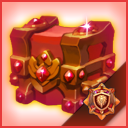

# 📁 Ranking Rewards

### <mark style="color:purple;">**📜Header List**</mark>

* ✅[Ranking Rules](ranking-rewards.md#trophy)
* ✅[Weekly Rewards](ranking-rewards.md#trophy-1)
* ✅[Ranking Buffs](ranking-rewards.md#trophy-2)

<figure><figcaption></figcaption></figure>

## ✅Ranking Rules 



### 📜 Ranking Rules

* Arena rankings are determined by the **number of Trophies earned**.
* If multiple players have the same number of Trophies,\
  the player with **higher total accumulated EXP** ranks higher.

***

### ◾ Tie Handling

If both **Trophies and total EXP** are the same, those players are assigned **the same rank**.

* If Player A and Player B are tied for **1st place**,\
  → the next rank starts at **3rd place**.

***

### ◾ Ranking Period & Rewards

* **Ranking Period**: Monday 00:00 – Sunday 23:59 (KST)
* **Reward Distribution**:\
  Rewards are sent via in-game mail based on rankings at **Sunday 23:59 (KST)**.\
  _(Once per week)_

***

### ◾ Ranking Board

* The ranking board displays up to **Top 200 players**.



### 📜 랭킹 규칙

* 아레나 랭킹은 **획득한 트로피 수**를 기준으로 결정됩니다.
* 트로피가 같을 경우, **누적 EXP가 높은 유저**가 상위 랭크를 차지합니다.

***

### ◾ 동점 처리

트로피와 누적 EXP가 모두 같을 경우, 해당 유저들은 **같은 순위**로 처리됩니다.

* A와 B가 공동 1위일 경우\
  → 다음 순위는 **3위부터 시작**합니다.

***

### ◾ 집계 및 보상

* **집계 기간**: 월요일 00:00 \~ 일요일 23:59 (KST)
* **보상 지급**: 일요일 23:59 기준, 우편 지급 (주 1회)

***

### ◾ 랭킹 보드

* 랭킹은 **최대 200위까지** 공개됩니다.



### 📜 ランキングルール

* アリーナランキングは、**獲得したトロフィー数** を基準に決定されます。
* トロフィー数が同じ場合は、**累積EXPが高いプレイヤー** が上位にランクされます。

***

### ◾ 同順位の処理

トロフィー数と累積EXPが **どちらも同じ場合**、\
該当するプレイヤーは **同じ順位** として扱われます。

* プレイヤーAとプレイヤーBが **同率1位** の場合、\
  → 次の順位は **3位から** 開始されます。

***

### ◾ 集計・報酬

* **集計期間**：月曜日 00:00 ～ 日曜日 23:59（KST）
* **報酬配布**：\
  日曜日 23:59（KST）時点の順位に基づき、**ゲーム内メールで配布**されます。（週1回）

***

### ◾ ランキングボード

* ランキングボードは **上位200位まで** 表示されます。



## ✅Weekly Rewards 

<figure><figcaption></figcaption></figure>

<table data-header-hidden><thead><tr><th></th><th></th><th width="149"></th><th></th><th></th></tr></thead><tbody><tr><td><strong>Rank</strong></td><td><strong>Arena Seal</strong></td><td><strong>Arena Coin</strong></td><td><strong>Gold</strong></td><td><strong>XTO</strong></td></tr><tr><td>1</td><td>100</td><td>100</td><td>     40,000,000</td><td>500</td></tr><tr><td>2</td><td>90</td><td>90</td><td>     35,000,000</td><td>400</td></tr><tr><td>3</td><td>85</td><td>85</td><td>     30,000,000</td><td>300</td></tr><tr><td>4</td><td>80</td><td>80</td><td>      25,000,000</td><td>200</td></tr><tr><td>5</td><td>75</td><td>75</td><td>      18,000,000</td><td>100</td></tr><tr><td>6</td><td>72</td><td>72</td><td>      14,000,000</td><td></td></tr><tr><td>7</td><td>70</td><td>70</td><td>      11,000,000</td><td></td></tr><tr><td>8</td><td>68</td><td>68</td><td>      9,000,000</td><td></td></tr><tr><td>9</td><td>66</td><td>66</td><td>      8,000,000</td><td></td></tr><tr><td>10</td><td>64</td><td>64</td><td>       6,000,000</td><td></td></tr><tr><td>11</td><td>60</td><td>60</td><td>       4,000,000</td><td></td></tr><tr><td>12</td><td>58</td><td>58</td><td>       3,500,000</td><td></td></tr><tr><td>13</td><td>56</td><td>56</td><td>       3,000,000</td><td></td></tr><tr><td>14</td><td>54</td><td>54</td><td>       2,800,000</td><td></td></tr><tr><td>15</td><td>52</td><td>52</td><td>       2,600,000</td><td></td></tr><tr><td>16</td><td>50</td><td>50</td><td>       2,400,000</td><td></td></tr><tr><td>17</td><td>48</td><td>48</td><td>       2,200,000</td><td></td></tr><tr><td>18</td><td>46</td><td>46</td><td>       2,100,000</td><td></td></tr><tr><td>19</td><td>44</td><td>44</td><td>       2,000,000</td><td></td></tr><tr><td>20</td><td>42</td><td>42</td><td>       1,900,000</td><td></td></tr><tr><td>21</td><td>40</td><td>40</td><td>       1,800,000</td><td></td></tr><tr><td>22</td><td>39</td><td>39</td><td>       1,700,000</td><td></td></tr><tr><td>23</td><td>38</td><td>38</td><td>       1,600,000</td><td></td></tr><tr><td>24</td><td>37</td><td>37</td><td>       1,500,000</td><td></td></tr><tr><td>25</td><td>36</td><td>36</td><td>       1,400,000</td><td></td></tr><tr><td>26</td><td>35</td><td>35</td><td>       1,300,000</td><td></td></tr><tr><td>27</td><td>34</td><td>34</td><td>       1,200,000</td><td></td></tr><tr><td>28</td><td>33</td><td>33</td><td>       1,100,000</td><td></td></tr><tr><td>29</td><td>32</td><td>32</td><td>       1,000,000</td><td></td></tr><tr><td>30</td><td>31</td><td>31</td><td>         900,000</td><td></td></tr><tr><td>31</td><td>30</td><td>30</td><td>         800,000</td><td></td></tr><tr><td>32</td><td>29</td><td>29</td><td>         700,000</td><td></td></tr><tr><td>33</td><td>28</td><td>28</td><td>         600,000</td><td></td></tr><tr><td>34</td><td>27</td><td>27</td><td>         550,000</td><td></td></tr><tr><td>35</td><td>26</td><td>26</td><td>         530,000</td><td></td></tr><tr><td>36</td><td>25</td><td>25</td><td>         510,000</td><td></td></tr><tr><td>37</td><td>24</td><td>24</td><td>         490,000</td><td></td></tr><tr><td>38</td><td>23</td><td>23</td><td>         470,000</td><td></td></tr><tr><td>39</td><td>22</td><td>22</td><td>         450,000</td><td></td></tr><tr><td>40</td><td>21</td><td>21</td><td>         430,000</td><td></td></tr><tr><td>41</td><td>20</td><td>20</td><td>         410,000</td><td></td></tr><tr><td>42</td><td>19</td><td>19</td><td>         390,000</td><td></td></tr><tr><td>43</td><td>18</td><td>18</td><td>         380,000</td><td></td></tr><tr><td>44</td><td>17</td><td>17</td><td>         360,000</td><td></td></tr><tr><td>45</td><td>16</td><td>16</td><td>         350,000</td><td></td></tr><tr><td>46</td><td>15</td><td>15</td><td>         340,000</td><td></td></tr><tr><td>47</td><td>14</td><td>14</td><td>         300,000</td><td></td></tr><tr><td>48</td><td>13</td><td>13</td><td>         280,000</td><td></td></tr><tr><td>49</td><td>12</td><td>12</td><td>         270,000</td><td></td></tr><tr><td>50</td><td>11</td><td>11</td><td>         260,000</td><td></td></tr><tr><td>10%</td><td>6</td><td>6</td><td>         250,000</td><td></td></tr><tr><td>30%</td><td>4</td><td>4</td><td>         100,000</td><td></td></tr><tr><td>60%</td><td>2</td><td>2</td><td>           50,000</td><td></td></tr></tbody></table>

&#x20;                                                             _Weekly Ranking Rewards_

## ✅Ranking Buffs 

<figure><figcaption>
Arena Ranker Effect
</figcaption></figure>



### 📜 Ranking Buffs

Adventurers ranked in the **Top 10** of the Arena\
receive **special bonus effects** while maintaining their rank.

***

### ◾ Top 10 Ranking Benefits

The following benefits are granted to players ranked **1st through 10th**\
in the Arena.

* **Real-time Damage Increase Buff**
* **Exclusive Ranker Visual Effect**

These effects remain active **only while you stay within the Top 10**.

***

### ◾Ranking Buff Notes

* Ranking buffs are **applied automatically**.
* If you fall out of the Top 10,\
  **all buffs and visual effects are removed immediately**.

***

### ◾ Ranking Buff Details

Detailed buff values based on rank can be found in the table below.

<table><thead><tr><th width="150.33333333333331" align="center">Rank</th><th width="373" align="center">Buff</th></tr></thead><tbody><tr><td align="center">1</td><td align="center">Damage +5%</td></tr><tr><td align="center">2</td><td align="center">Damage +4.6%</td></tr><tr><td align="center">3</td><td align="center">Damage +4.2%</td></tr><tr><td align="center">4</td><td align="center">Damage +3.8%</td></tr><tr><td align="center">5</td><td align="center">Damage +3.4%</td></tr><tr><td align="center">6</td><td align="center">Damage +3%</td></tr><tr><td align="center">7</td><td align="center">Damage +2.6%</td></tr><tr><td align="center">8</td><td align="center">Damage +2.2%</td></tr><tr><td align="center">9</td><td align="center">Damage +1.8%</td></tr><tr><td align="center">10</td><td align="center">Damage +1.4%</td></tr></tbody></table>

✨

> **True strength is proven by records.**\
> **Reach the Top 10, and wield the power that comes with it.**



### 📜 랭킹 버프

아레나에서 **TOP 10**에 랭크된 모험가는 랭킹을 유지하는 동안 **특별한 보너스 효과**를 받게 됩니다.

***

### ◾ TOP 10 랭킹 특전

아레나 랭킹 **1위 \~ 10위** 유저에게는 다음 혜택이 적용됩니다.

* **실시간 데미지 증가 버프**
* **랭커 전용 이펙트**

해당 효과는 **TOP 10 랭킹을 유지하는 동안만 적용**됩니다.

***

### ◾ 랭킹 버프 안내

* 랭킹 버프는 **자동으로 적용**됩니다.
* 랭킹에서 벗어날 경우, **버프와 이펙트는 즉시 해제**됩니다.

***

### ◾ 랭킹 버프 상세

랭킹에 따른 버프 효과의 상세 수치는 아래 표를 참고해 주세요.

<table><thead><tr><th width="150.33333333333331" align="center">Rank</th><th width="373" align="center">Buff</th></tr></thead><tbody><tr><td align="center">1</td><td align="center">Damage +5%</td></tr><tr><td align="center">2</td><td align="center">Damage +4.6%</td></tr><tr><td align="center">3</td><td align="center">Damage +4.2%</td></tr><tr><td align="center">4</td><td align="center">Damage +3.8%</td></tr><tr><td align="center">5</td><td align="center">Damage +3.4%</td></tr><tr><td align="center">6</td><td align="center">Damage +3%</td></tr><tr><td align="center">7</td><td align="center">Damage +2.6%</td></tr><tr><td align="center">8</td><td align="center">Damage +2.2%</td></tr><tr><td align="center">9</td><td align="center">Damage +1.8%</td></tr><tr><td align="center">10</td><td align="center">Damage +1.4%</td></tr></tbody></table>

✨

> **강자는 기록으로 증명됩니다.**\
> **TOP 10에 올라, 그 자리에 걸맞은 힘을 누리세요.**



### 📜 ランキングバフ

アリーナで **TOP 10** にランクインした冒険者は、その順位を維持している間、\
**特別なボーナス効果** を受けることができます。

***

### ◾ TOP 10 ランキング特典

アリーナランキング **1位～10位** のプレイヤーには、以下の特典が付与されます。

* **リアルタイムダメージ増加バフ**
* **ランカー専用エフェクト**

これらの効果は、**TOP 10の順位を維持している間のみ有効** です。

***

### ◾ ランキングバフ案内

* ランキングバフは **自動的に適用** されます。
* TOP 10から外れた場合、**バフおよびエフェクトは即時解除** されます。

***

### ◾ ランキングバフ詳細

ランキングに応じた バフ効果の詳細数値については、以下の表をご確認ください。

<table><thead><tr><th width="150.33333333333331" align="center">Rank</th><th width="373" align="center">Buff</th></tr></thead><tbody><tr><td align="center">1</td><td align="center">Damage +5%</td></tr><tr><td align="center">2</td><td align="center">Damage +4.6%</td></tr><tr><td align="center">3</td><td align="center">Damage +4.2%</td></tr><tr><td align="center">4</td><td align="center">Damage +3.8%</td></tr><tr><td align="center">5</td><td align="center">Damage +3.4%</td></tr><tr><td align="center">6</td><td align="center">Damage +3%</td></tr><tr><td align="center">7</td><td align="center">Damage +2.6%</td></tr><tr><td align="center">8</td><td align="center">Damage +2.2%</td></tr><tr><td align="center">9</td><td align="center">Damage +1.8%</td></tr><tr><td align="center">10</td><td align="center">Damage +1.4%</td></tr></tbody></table>

✨

> **強さは、記録によって証明されます。**\
> **TOP 10に立ち、その座にふさわしい力を手に入れましょう。**



<em>※ This guide was written based on the game status as of January 13, 2026,</em>  <em>and its contents may change with future updates.</em>

